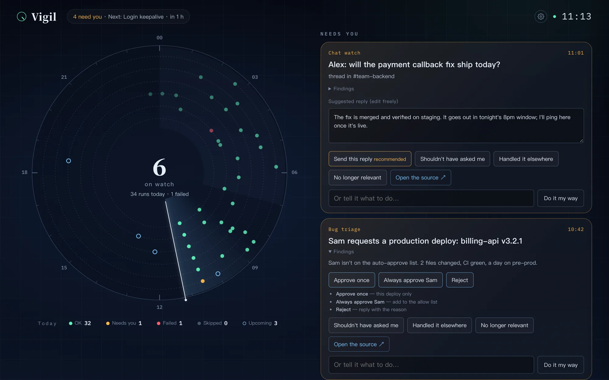
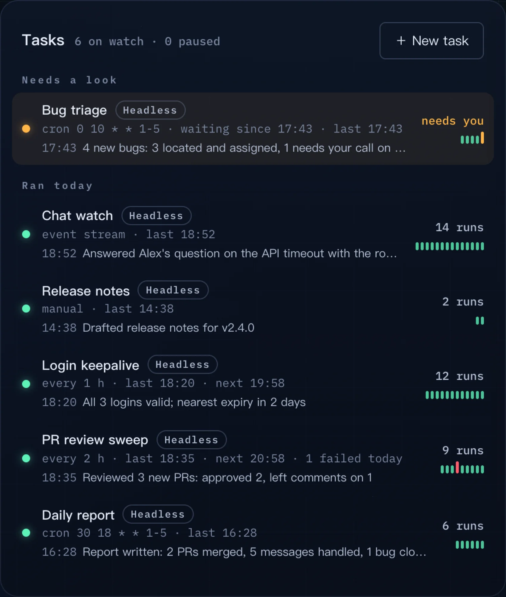
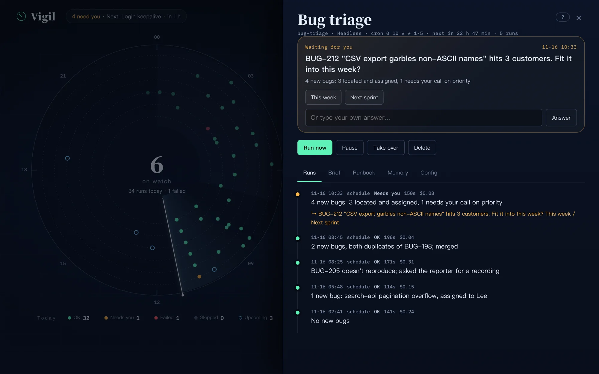

# Vigil

[中文](README.zh-CN.md)

Vigil is an always-on AI watch for your Mac. Three things set it apart:

- **It never expires.** A launchd daemon owns the schedule, so nothing depends on a chat session staying alive.
- **It heals itself.** It recovers from hung sessions and crashed processes.
- **It gets better with use.** It ships with a self-evolution task that learns from your feedback.

Describe a job in one sentence. Vigil talks it through with you, does a trial run, and then keeps doing the job on a schedule or whenever events arrive. When it needs you, it brings you the question, its analysis, and a suggested reply.

The agents run on [Claude Code](https://claude.com/claude-code)'s `claude` CLI. Vigil handles time, events, queueing, memory, and recovery; the AI only does the work.



## Features

- **Triggers**: cron, interval, one-off, event stream, or manual. When the Mac wakes up after missing a round, it catches up with one run.
- **No lost events**: each stream line is written to disk first and acknowledged only after a successful round. If a round fails or the process dies, the line is delivered again next round.
- **Two execution modes**:
  - `headless` (default): a fresh `claude -p` per round.
  - `resident`: a long-lived agent kept inside herdr. Use it for event streams that need continuous context.
- **To-dos**: decisions come to you as to-do cards with an analysis and a suggested reply. You can send the reply as is, edit it, give an instruction, or dismiss the card.
- **Learning**: if you handle the same kind of to-do the same way three times in a row, Vigil suggests a standing rule. Rules you accept go into that task's memory.
- **Self-evolution** (built-in task `self-evolve`):
  - It turns your corrections, edits, instructions, and failed runs into improvements.
  - It makes small changes itself and asks you before anything that changes what a task is allowed to do.
  - It records every change in a ledger, checks each one against data when its review date comes, and reverts the ones that didn't help.
- **Follow-ups**: when an agent asks someone something on your behalf, Vigil tracks it. If there's no answer by the due time, it nudges once, then hands the matter to you. With Slack connected, a reply in the thread it is waiting in is handed back within five minutes, even when the reply does not mention you.
- **Cost control**:
  - `signal` pre-checks skip a round when nothing changed.
  - A light lane routes trivial batches to a cheaper model.
  - Costs are tracked per run.
- **Graceful upgrades**: reinstalling waits for running rounds to finish, and the queue survives the restart.
- **Take over**: open any run's session with `claude --resume` and keep chatting.

## Screenshots

Tasks at a glance: the one that needs you stays a full card, the rest fold into rows with their next run and recent results.



A task's detail: its question to you, the run history, and its brief, runbook and memory.



<sub>Screenshots use made-up sample data.</sub>

## Install

You need macOS (Apple silicon or Intel), a signed-in Claude Code (`claude` on your PATH), and [herdr](https://herdr.dev), a terminal workspace for coding agents: new tasks are talked through, and runs are taken over, in herdr.

```bash
curl -fsSL https://raw.githubusercontent.com/genkin-he/openvigil/main/scripts/install.sh | sh
```

If herdr is missing, the script offers to install it; without herdr, Vigil cannot be used. It then downloads the binary for your Mac, verifies its sha256 checksum, installs it to `~/.local/bin/vigil`, and registers and starts the launchd service. Run it again to upgrade. To build from source instead, run `make install` (requires Go).

Then open the console. On first visit a short guided tour walks you through creating your first task and the tabs of a task's page. **Settings** (top right) restarts the tour, switches the language, and picks a task list layout (grouped, compact, or grid) with a live preview; the **?** on a task's page repeats its tab tour.

```bash
vigil web          # http://127.0.0.1:7788
```

A fresh install has one task: **self-evolve**, which runs daily at 21:30. Until you add tasks of your own and give some feedback, each of its rounds just reports that there is no new feedback.

## Usage

```bash
vigil new "Every weekday at 9:30, send me yesterday's new errors ranked by impact"   # starts a forge session
vigil ls                          # tasks
vigil run <id> --wait             # run one round now and wait for the result
vigil todo list                   # to-dos waiting for you
vigil follow list                 # things Vigil is waiting on from others
vigil evolve ledger               # changes self-evolution made, and their verdicts
vigil retro --days 7              # weekly statistics
vigil pause|resume|rm <id>
vigil version
```

Each task is a set of files under `~/.vigil/tasks/<id>/`:

| File | Contents |
|---|---|
| `task.yaml` | configuration |
| `brief.md` | what the task is for |
| `runbook.md` | how it does the job |
| `memory.md` | long-term memory |
| `runs.jsonl` | one line per run |
| `logs/` | full transcripts of headless runs |

The `task.yaml` fields are documented in `internal/forge/prompt.go`, the guide the forge agent follows when it creates a task.

## Moving to another computer

```bash
vigil export                     # old machine: finish work in progress, stop the service, pack one archive (in ~ by default)
bin/vigil import <archive>       # new machine, after cloning and make build: unpack, rewrite paths, check, then make install once all pass
vigil doctor                     # check tools, logins and the repos/directories tasks use, any time
```

The archive holds all of `~/.vigil` plus the state directories listed under `migrate_extra` in `config.yaml`. The console token and logins never travel: a new token is made, and the check lists each login to redo. The old machine is marked as moved and refuses to start again, so two machines never answer the same messages.

The console does the same without a terminal: Settings → "Move & health check". "Run health check" lists every login, tool, repo and directory, with a fix hint for each one that fails. "Prepare a move" shows what will be packed and what the new machine needs; on confirm it runs `vigil export` in the background and shows the archive path, its log and the command to run on the new machine. Vigil on this machine stops once packing is done, so the page losing its connection is expected. A failed login check's to-do also has a "Full health check" button that opens this section.

## How self-evolution works

1. **Feedback** comes from four places:
   - an edited suggested reply;
   - an instruction you gave instead of the suggested reply;
   - failed, timed-out, needs-you, and permission-blocked runs;
   - with Slack connected, an "ai 回错了" ("the AI replied wrong") correction.

   Run `vigil evolve signals` to see everything since the last round.
2. **When it runs**: once a day. Strong feedback also wakes it within 15 minutes, at most four times a day.
3. **Tiered changes**:
   - It applies directly, after taking a backup: a lesson added to memory, memory cleanup, or a one-line clarification to a task's rules.
   - It asks you first about: rules that change a task's limits, taking back an authorization, and task configuration.
4. **Verification**: every change records the effect it should have and a review date. When that date comes, the data decides whether the change is kept or reverted.

To turn off the early wake-ups, set `evolve_task: "-"` in `config.yaml`. To remove the task entirely, run `vigil rm self-evolve`; it will not be re-added.

## Configuration

`~/.vigil/config.yaml`. Every field is optional.

| Field | Default | Meaning |
|---|---|---|
| `addr` | `127.0.0.1:7788` | console and API, loopback only |
| `max_concurrent` | 3 | tasks running at once |
| `webhook` | empty | needs-you and failure notices are POSTed here as `{"text": …}`; without it, Vigil shows a macOS notification |
| `checks` | `claude` | hourly health checks (name, command, fix, hint). A failure is fixed automatically if possible, otherwise it becomes a to-do |
| `probes` | none | extra lookups that close a follow-up as soon as what it waits for is settled (name, match regex on its link or ref, command). The command gets the link and ref as `$1` `$2` and prints `settled <outcome>` or `pending`. GitLab merge requests are looked up built in, through `glab` |
| `source_dir` | none | Vigil's own source repository. Set, agents may propose changes to Vigil's code with `vigil patch propose`; each shows its diff on a card and lands only after you click Apply in the console (Slack cannot approve it). Vigil then applies it in a scratch worktree, runs `make test`, fast-forwards `main` and runs `make install` |
| `follow_hours` | any time | when follow-ups may chase people, e.g. `10:00-19:00`: weekdays only, inside these hours; a follow-up due at night or on a weekend waits for the next working morning (public holidays are not known) |
| `evolve_task` | `self-evolve` | the task to wake on feedback; `-` turns this off |
| `launchd_label` | `dev.vigil.daemon` | the launchd service name |
| `slack` | empty | optional, see below |

### Optional: Slack

Setting `slack: {task: <stream task watching Slack>, self_dm: <your DM-with-yourself channel id>}` turns on three things:

- Every new to-do is also posted to your self-DM. Reply in its thread with 发 (send), 不用管 (dismiss), or an instruction to handle it.
- `vigil selftest` runs an end-to-end self-test over real Slack.
- "ai 回错了" corrections feed self-evolution.

This needs the `slackctl` CLI, which Vigil uses to post and read threads as you. It also needs a stream task whose command emits one line per message, in this format:

```
SLACK <channel>:<ts> thread=<thread_ts|-> user=<id> dm=<0|1> mention=<0|1> self=<0|1> | <snippet>
```

## Security

The API listens on 127.0.0.1 only and checks the Host header, so other websites in your browser cannot reach it. Any local process, however, can read `~/.vigil/token`, and that token can create tasks that run arbitrary commands. Only run Vigil on a Mac you do not share.

Agents run in Claude Code's `auto` permission mode. A task's `disallowed_tools` setting is a hard gate; for example, it can block `git push`.

## Development

```bash
make test                         # go vet + go test -race
make release                      # darwin arm64/amd64 archives and checksums in dist/
VIGIL_HOME=/tmp/vh vigil daemon   # foreground run with its own data dir (set another addr in its config.yaml)
```

The log is at `~/.vigil/vigil.log`.

## License

MIT
