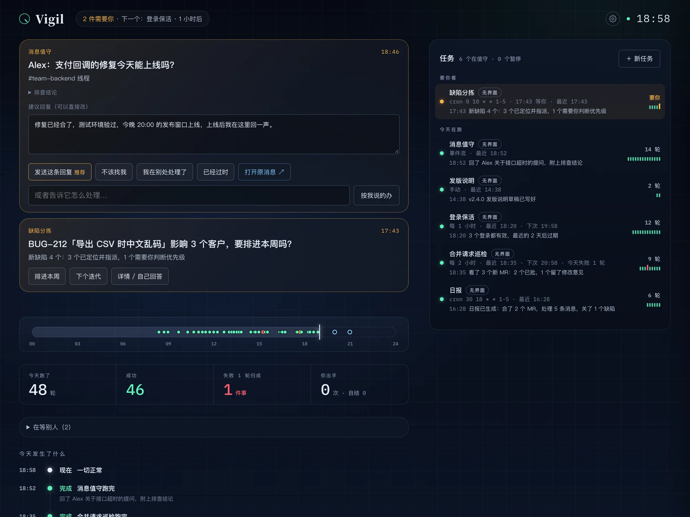
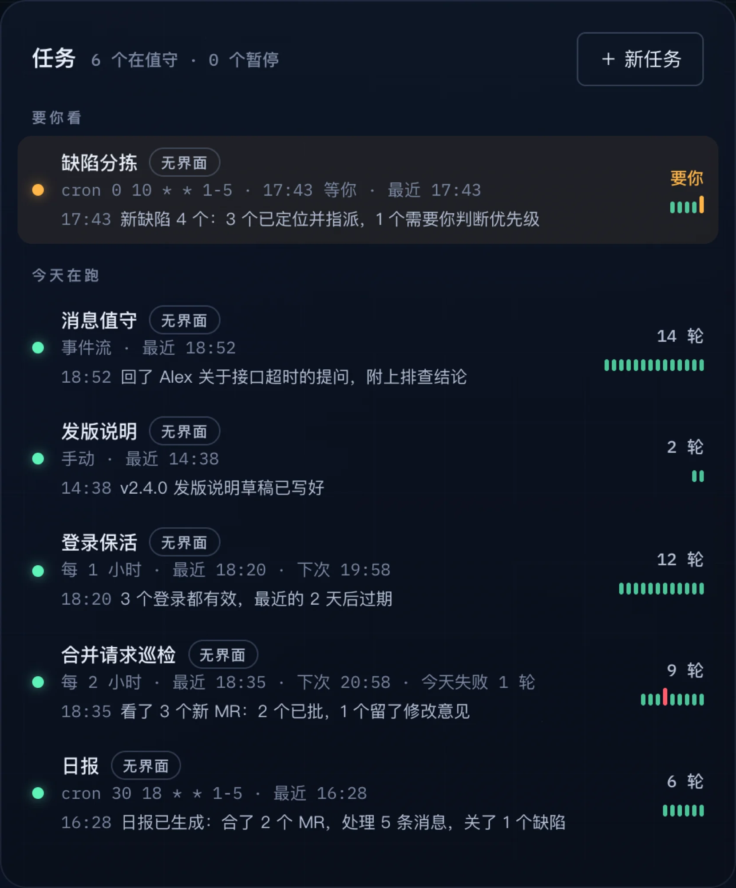

# Vigil

[English](README.md)

Vigil 是一个常驻在 Mac 上的 AI 值守：
- **不会过期**：调度由 launchd 守护进程负责。
- **会自愈**：会话卡住、进程退出都能自己恢复。
- **越用越好**：自带一个自进化任务，从你的反馈里学习。

用一句话交代一件事，它会先和你聊清楚、试跑一轮，然后按时间或按事件一直做下去。需要你的时候，它把问题、分析和建议回复摆到你面前。

AI 由 [Claude Code](https://claude.com/claude-code) 的 `claude` 命令驱动。Vigil 负责时间、事件、排队、记忆和自愈，AI 只负责干活。



## 特点

- **调度方式**：cron、固定间隔、一次性、事件流、手动都支持。机器睡眠时错过的轮次，醒来后补跑一轮。
- **事件不丢**：事件流的每一行先落盘，这一轮成功了才确认；失败或进程退出，下一轮接着投递。
- **两种执行模式**：
  - `headless`（默认）：每轮起一个 `claude -p`，跑完就退出。
  - `resident`：在 herdr 里常驻，适合需要连续上下文的事件流。
- **待办**：要你拍板的事写成待办，带分析和建议回复。你可以原样发出、改了再发、写一句指示，或者标「不用管」。
  - 待办还开着时，你在 Slack 线程或私聊里亲手回了，下一次收集时按「我在别处处理了」自动结案，并记下你回的话。只有你能办的待办、规则 / 收回 / 改代码这类卡片，以及「稍等」「我看看」这种缓兵回复，不会被这样结掉。
  - 常驻 agent 停在 Claude Code 的确认框（Yes/No）时，也会生成一条待办，按钮就是确认框的选项，点了直接在 agent 会话里按下；按之前会核对屏幕上还是同一个确认框。
- **越用越自动**：同一类事，你连续 3 次都原样发出或都标「不用管」，Vigil 会提一条规则建议，采纳后写进任务的长期记忆。
- **自进化**（内置任务 `self-evolve`）：
  - 学习你的反馈：纠错、改写、指示，以及失败的轮次。
  - 小改动直接做；改变行为边界的改动要你批准。
  - 每处改动都记进变更账本，到期用数据验证，没用的撤掉。
- **跟进**：agent 替你问了别人之后会登记一条跟进。到期没回音就追问一次，还没回音就交给你。接了 Slack 的话，对方在等待的线程里回复（哪怕没 @你），5 分钟内就会交回原任务处理。
  - 控制台「在等别人」里每条跟进都有 ✓ 和 ×。觉得对方已经办好了（比如对方点完了却没回话），点 ✓ 让原任务马上去核实：办完了就接着做后面的事（通知、回复、关单）再结掉，没办完就继续等，不追问、不改到期时间。不用再等了点 ×。
- **Runbook 由 AI 逐步完善**：AI 在干活中提出的 runbook 修改先挂着等你批准；有待批修改的任务，任务列表里名字后面会有一个橙色小点，悬停能看到有几条。
- **记忆分两处**：`memory.md` 只放规则（决策、纠错、教训、授权），每轮都读，上限 30 KB，超了由自进化把同类规则合并、提炼进 runbook；查到的事实（表在哪、命令怎么写）按主题放进 `knowledge/<主题>.md`，prompt 里只列目录，用到哪个主题才读哪个，同一条事实不会重复写。
- **省钱**：
  - `signal` 预检：便宜命令的输出没变，就跳过这一轮。
  - 轻量通道：一批事件全是简单消息时，换便宜模型跑。
  - 成本按单轮记账。
  - 每一轮可以报告新产出（MR、评论、工单，带链接）。回顾和任务详情按任务统计近 7 天的新产出、代回数、被采纳的草稿数，以及平均每个产出花多少钱。
- **不打断地升级**：重装时等正在跑的轮次跑完再重启，排队中的请求会落盘保存。
- **接管**：一键用 `claude --resume` 打开任意一轮的会话，上下文都在。

## 截图

任务一览：需要你的任务保持大卡片，其余折成一行，显示下次运行时间和最近几轮的结果。



任务详情：它在等你回答的问题、每一轮的记录，以及需求、Runbook 和记忆。


<sub>截图里的数据都是虚构的示例。</sub>

## 安装

需要 macOS（Apple 芯片或 Intel）、已经登录的 Claude Code（`claude` 命令在 PATH 里），以及 [herdr](https://herdr.dev)（给编程 agent 用的终端工作区）：新建任务的对话、接管某一轮的会话都在 herdr 里进行。

```bash
curl -fsSL https://raw.githubusercontent.com/genkin-he/openvigil/main/scripts/install.sh | sh
```

安装脚本做四件事：
1. 检查 herdr，没装就问你要不要装；不装的话 Vigil 用不了，脚本会退出；
2. 下载对应架构的二进制，校验 sha256；
3. 放到 `~/.local/bin/vigil`；
4. 注册 launchd 服务并启动。

再跑一次就是升级。也可以从源码安装：`make install`（需要 Go）。

装好后打开控制台。新手引导分三段：
1. **第一次打开**：带你建第一个任务；
2. **第一次打开任务详情**：介绍操作按钮和每个 tab；
3. **有了自己的任务之后**：主页导览，依次介绍顶部状态、24 小时表盘、今天的统计、待办卡片、「在等别人」、任务列表上的标签和设置。页面上暂时没有的部分（比如还没有待办）会自动跳过。

右上角的 **设置** 里可以重新开始引导、单独重看主页导览、切换语言、选任务列表的样式（分组折叠、紧凑单行、卡片网格），选的时候直接在页面上预览；任务详情里的 **?** 只重看各个 tab 的介绍。

```bash
vigil web          # http://127.0.0.1:7788
```

第一次启动只有一个任务：**自进化**（`self-evolve`，每天 21:30 跑）。在你加了自己的任务、产生反馈之前，它每轮只写一句「没有新反馈」。

## 用法

```bash
vigil new "工作日每天 9:30 把昨天的新错误按影响排序发我"   # 起锻造会话，聊清楚后建任务
vigil ls                          # 任务列表
vigil run <id> --wait             # 立即跑一轮并等结果
vigil todo list                   # 等你处理的待办
vigil follow list                 # 在等别人回复的事
vigil evolve ledger               # 自进化做过的改动和结论
vigil retro --days 7              # 一周统计
vigil pause|resume|rm <id>
vigil version
```

每个任务是 `~/.vigil/tasks/<id>/` 下的一组文件：

| 文件 | 内容 |
|---|---|
| `task.yaml` | 配置 |
| `brief.md` | 需求 |
| `runbook.md` | 做法 |
| `memory.md` | 长期记忆 |
| `knowledge/<主题>.md` | 按主题存的事实，用到才读 |
| `memory.archive.md` | 旧版挪出来的事务流水（只读） |
| `runs.jsonl` | 每一轮的记录 |
| `logs/` | 无界面运行的完整过程 |

`task.yaml` 各字段的说明见 `internal/forge/prompt.go`，也就是锻造师建任务时参照的那份。

## 换电脑

```bash
vigil export                     # 旧电脑：跑完进行中的活，停掉服务，打成一个包（默认放在 ~ 下）
bin/vigil import <包>            # 新电脑：clone 仓库并 make build 后执行；解包、改路径、体检，全部就绪才 make install
vigil doctor                     # 随时体检：工具、登录、任务用到的仓库和目录
```

包里是 `~/.vigil` 的全部数据，加上 `config.yaml` 里 `migrate_extra` 列出的、任务放在别处的状态目录。控制台 token 和各平台登录不打包：新电脑会重新生成 token，登录按体检提示逐个完成。导出后旧电脑上的 Vigil 会被标记为已搬走，不会再启动，避免两台电脑重复回复。

不想敲命令也可以在控制台里做：设置 →「搬家与体检」。「运行体检」逐项列出登录、工具、仓库和目录，没通过的附上修复提示；「准备搬家」先列出会打包什么、新电脑要准备什么，确认后在后台跑 `vigil export`，并给出包的路径、日志和新电脑上要执行的命令。打包完成后这台电脑的 Vigil 会停止，页面断开连接是正常的。登录检查失败的待办上也有「全面体检」按钮直达这里。

## 自进化怎么工作

1. **反馈**有四种来源：
   - 你在待办里改了建议回复再发；
   - 你没用建议回复，改成下指示；
   - 失败、超时、needs_you、被权限拦下的轮次；
   - 接了 Slack 的话，你说「ai 回错了」的纠错。

   `vigil evolve signals` 能看到上一轮以来的全部反馈。
2. **什么时候跑**：每天 21:30 跑一轮，看全部任务（判断原则、跨任务的事、周报）。有反馈（纠错、改写、指示、亲手回复）时 15 分钟内提前跑，**按任务分开**：每个有反馈的任务各起一轮，只看这个任务的数据、只改它的文件；连着来的反馈并成一轮，每天最多 8 轮。
3. **分级改动**：
   - 直接改：记教训、整理记忆、补一句澄清。改之前都会备份。
   - 要你批：改变行为边界的规则、收回授权、改任务配置。
4. **验证**：每处改动都写明期望效果和复查日期。到期拿数据判断，有用就保留，没用就撤销。

自进化是系统保留任务，可以暂停，不能删除。要关掉：在 `config.yaml` 里写 `evolve_task: "-"`（不再被反馈叫醒），再暂停这个任务（不跑每日例行轮）。

## 配置

`~/.vigil/config.yaml`，不存在时全部用默认值：

| 字段 | 默认 | 说明 |
|---|---|---|
| `addr` | `127.0.0.1:7788` | 控制台和 API，只监听本机 |
| `max_concurrent` | 3 | 同时运行的任务数上限 |
| `webhook` | 空 | 需要你处理或任务失败时推送到这里（POST `{"text": …}`）；不填就弹 macOS 系统通知 |
| `checks` | 检查 `claude` | 每小时一次的自检（名称、命令、自动修复命令、提示）。失败先尝试自动修，修不好就写一条待办 |
| `probes` | 无 | 给跟进加的查询：链接或 ref 匹配某个规则（name、match 正则、command）时，用这条命令查状态，办完了跟进立即结束。命令收到的参数是 `$1` 链接、`$2` ref，输出 `settled <结果>` 或 `pending`。GitLab MR 内置支持，用的是 `glab` |
| `source_dir` | 无 | Vigil 源码仓库的路径。配了之后，agent 可以用 `vigil patch propose` 提议改 Vigil 自己的代码：卡片上显示 diff，你在控制台点「应用这个改动」才会生效（Slack 里确认不算）。Vigil 会在临时工作区里应用 diff、跑 `make test`，通过后快进合并 `main`，再执行 `make install` |
| `follow_hours` | 任何时间 | 跟进追问别人的时间，例如 `10:00-19:00`：只在周一到周五的这个时段追问，晚上和周末到期的顺延到下一个工作日早上（不认法定节假日） |
| `evolve_task` | `self-evolve` | 有反馈时要提前叫醒的任务；填 `-` 关闭 |
| `launchd_label` | `dev.vigil.daemon` | launchd 服务名 |
| `slack` | 空 | 可选，见下文 |

### 可选：Slack

配置 `slack: {task: <监听 Slack 的流式任务>, self_dm: <你和自己的私聊频道 ID>}` 后，会多出三项功能：
- 每条新待办同时发到你的 Slack 自聊。在那条消息的线程里回「发」「不用管」或一段指示，就能处理这条待办。
- `vigil selftest`：用真实的 Slack 跑一遍端到端自测。
- 「ai 回错了」纠错会进入自进化。

这些功能需要 `slackctl` 命令行（Vigil 用它以你的身份发消息、读线程），再加一个流式任务，把收到的消息转成下面这种行：

```
SLACK <channel>:<ts> thread=<thread_ts|-> user=<id> dm=<0|1> mention=<0|1> self=<0|1> | <消息摘要>
```

## 安全边界

API 只监听 127.0.0.1，并校验 Host 头，所以浏览器里的其他网站拿不到 token。但本机任何进程都能读到 `~/.vigil/token`，而这个 token 能创建任务、跑任意命令。只在你一个人用的 Mac 上启用 Vigil。

agent 默认用 Claude Code 的 `auto` 权限模式运行。任务的 `disallowed_tools` 是硬闸门，比如不允许 `git push`。

## 开发

```bash
make test                         # go vet + go test -race
make release                      # dist/ 下生成 darwin arm64/amd64 发布包和校验和
VIGIL_HOME=/tmp/vh vigil daemon   # 用独立的数据目录前台运行（在 config.yaml 里换一个端口）
```

日志在 `~/.vigil/vigil.log`。

## 许可

MIT
